# Diagrammes CineVerse

Les diagrammes **AS-IS** décrivent les flux observés. Les diagrammes **TO-BE** explicitent uniquement la cible recommandée. Mermaid est utilisé pour rester rendable dans la plupart des forges Markdown.

## 1. Diagramme de contexte — AS-IS

CineVerse centralise l'expérience et les données de profil, mais ne transporte pas le flux vidéo.

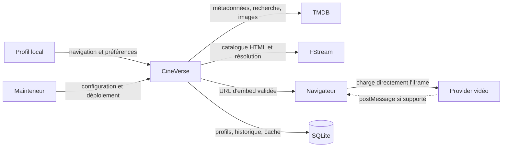

## 2. Diagramme de cas d'utilisation — AS-IS

Les fonctions nécessitant un profil actif sont regroupées autour de l'acteur principal.

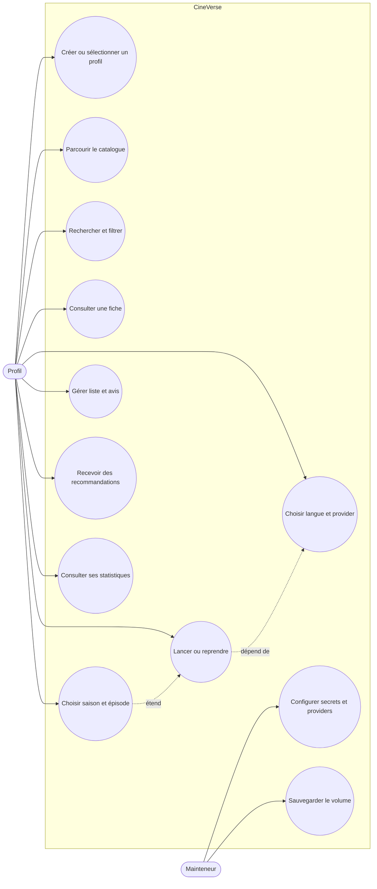

## 3. Diagramme de composants — AS-IS

Les composants sont modulaires mais déployés dans un seul processus.

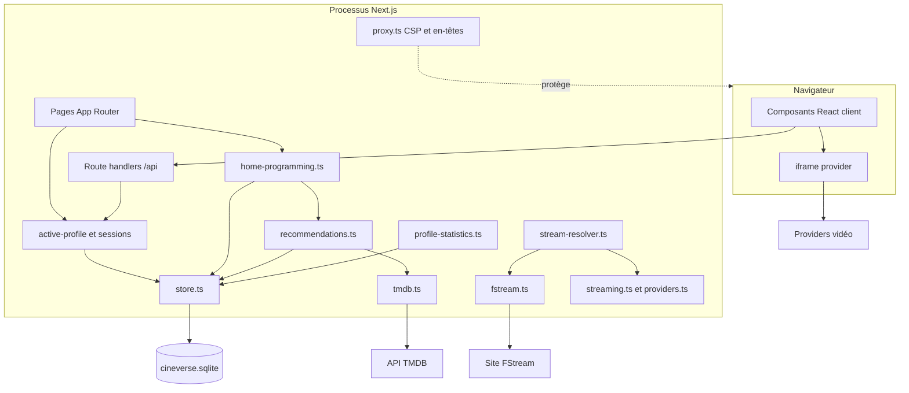

## 4. Diagramme de classes du domaine — TO-BE

Cette vue reprend les concepts cibles sans imposer un ORM.

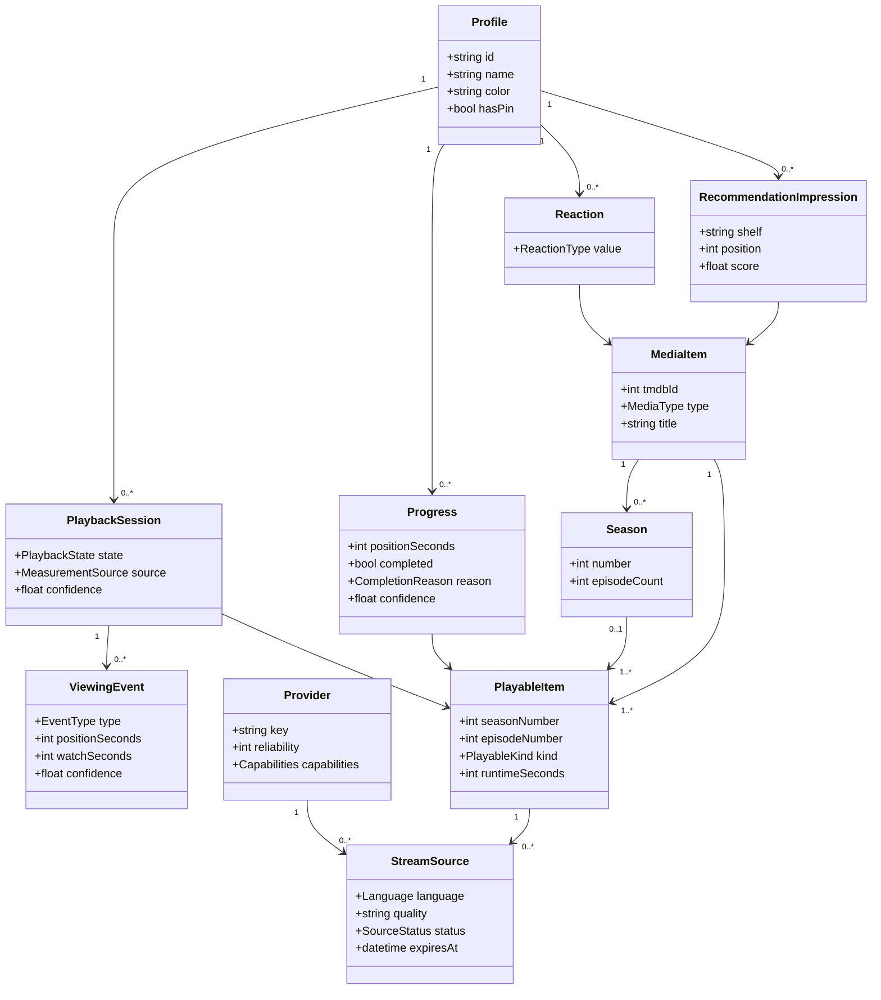

## 5. Diagramme de déploiement — AS-IS

Le stockage local rend le déploiement mono-instance.

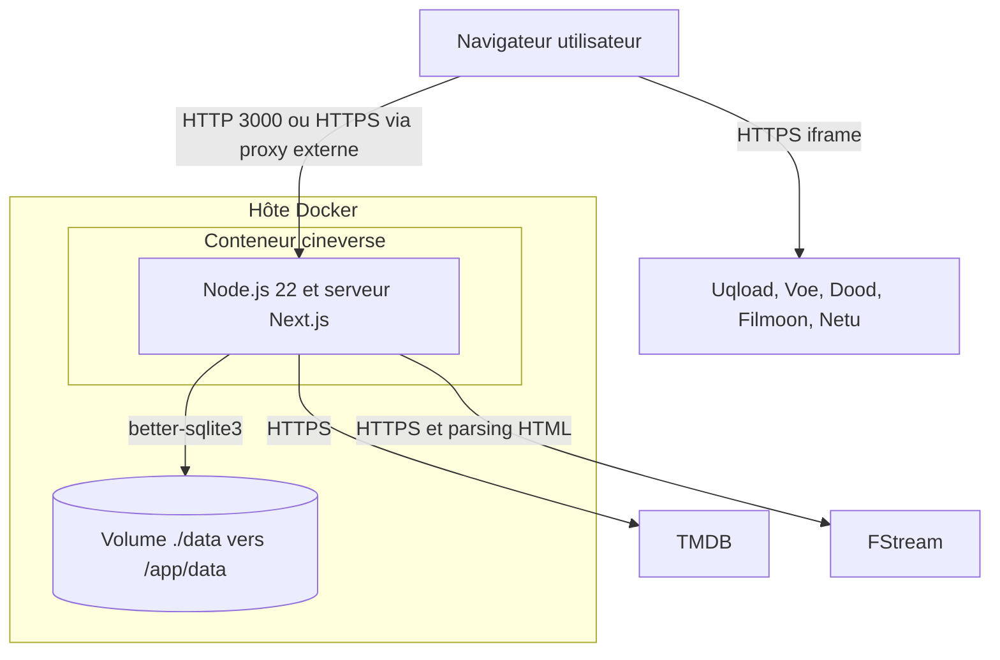

## 6. Diagramme entité-association — TO-BE

Le détail des attributs est dans [03-data-and-merise.md](./03-data-and-merise.md) et [schema.dbml](./schema.dbml).

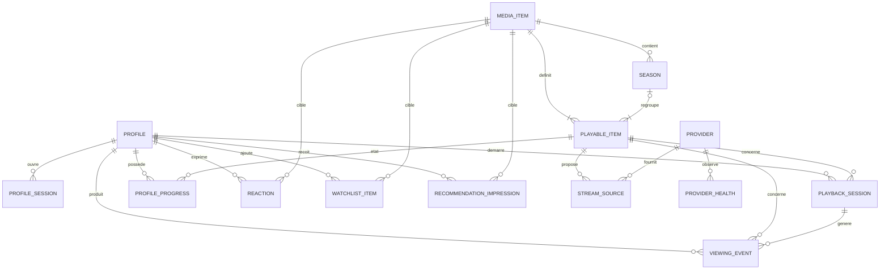

## 7. Séquence de recherche d'un contenu — AS-IS

La recherche de page combine TMDB et classement local ; l'API de suggestions sert la saisie rapide.

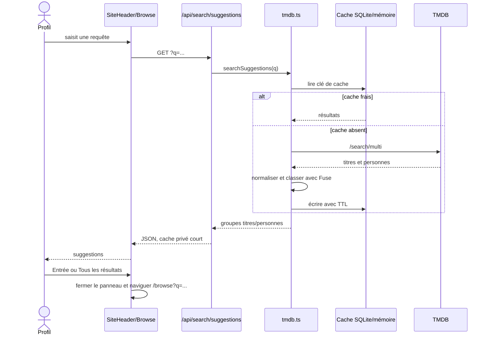

## 8. Séquence de résolution d'un provider — AS-IS

La validation TMDB et l'allowlist empêchent d'accepter aveuglément un résultat FStream.

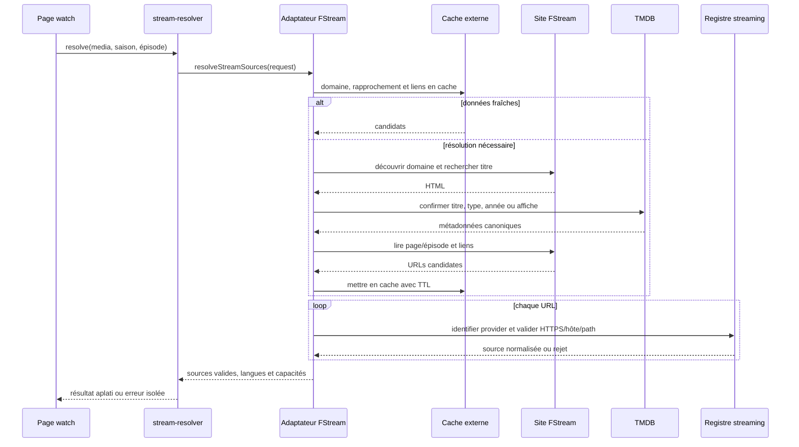

## 9. Séquence de démarrage d'une lecture — AS-IS

Le démarrage prouve une intention, pas une durée regardée.

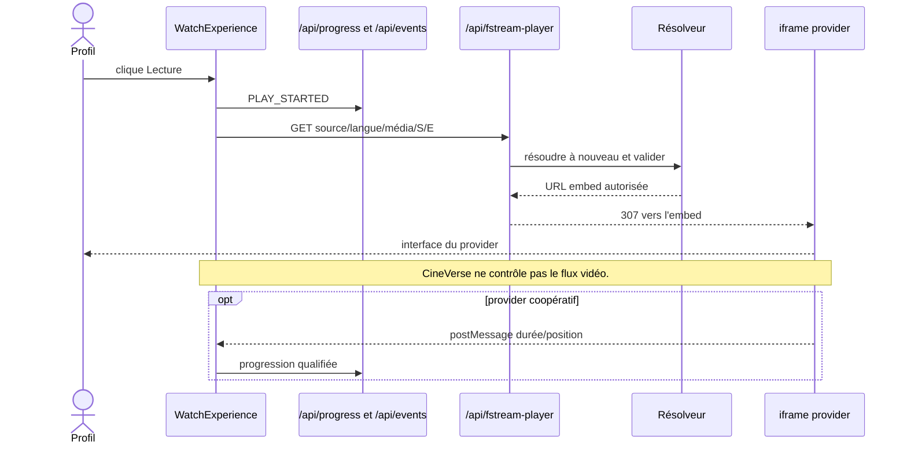

## 10. Séquence de sauvegarde de progression — AS-IS et limite TO-BE

Le temps ajouté est borné par le temps mural. La cible ajoute provenance, confiance et idempotence.

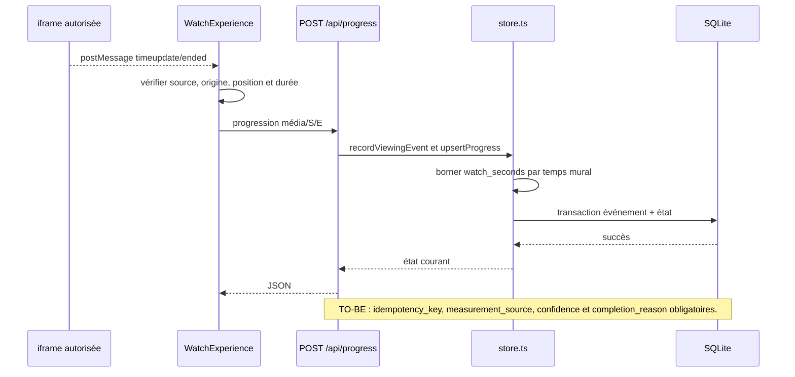

## 11. Séquence de génération des recommandations — AS-IS

Le moteur est hybride, basé sur des règles et des sources TMDB.

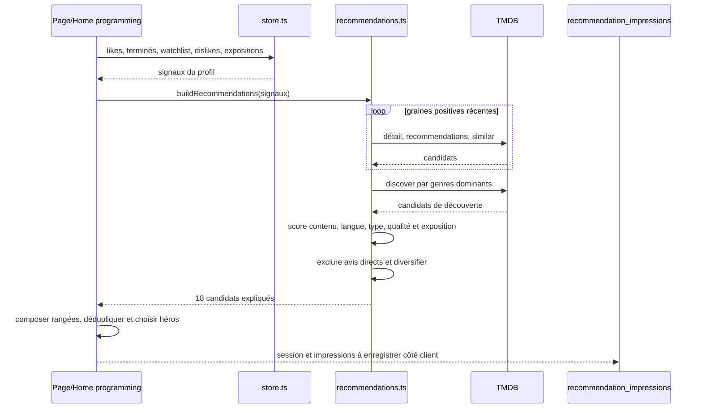

## 12. Diagramme d'état d'une session de lecture — TO-BE

`PAUSE_ESTIMEE` et `INDETERMINE` sont nécessaires quand l'iframe ne révèle pas son état réel.

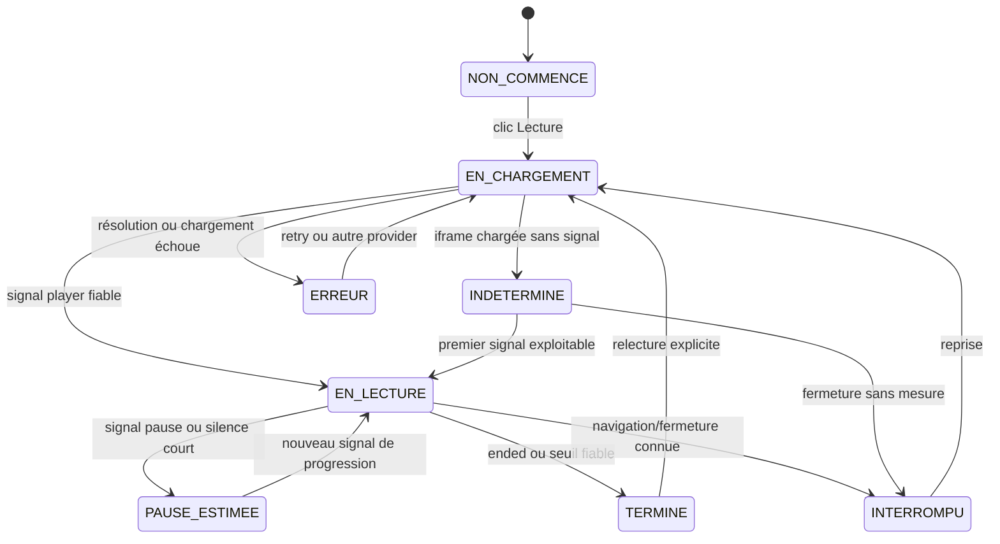

## 13. État d'un film ou épisode pour un profil — TO-BE

L'état personnel est une projection et non une copie brute de la session player.

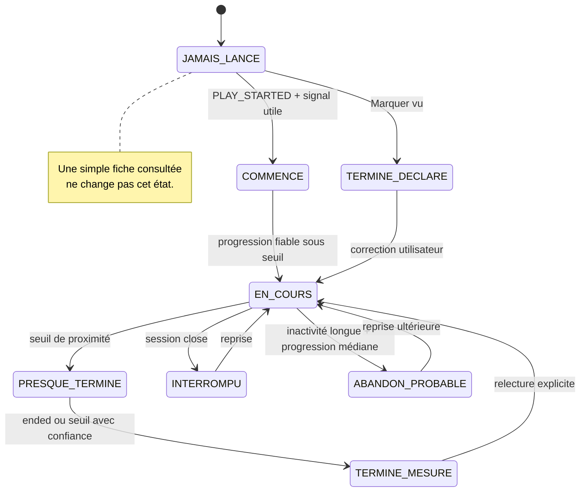

## 14. Flux de données TMDB, cache et providers — AS-IS

La base garde les données personnelles ; les réponses externes sont temporaires.

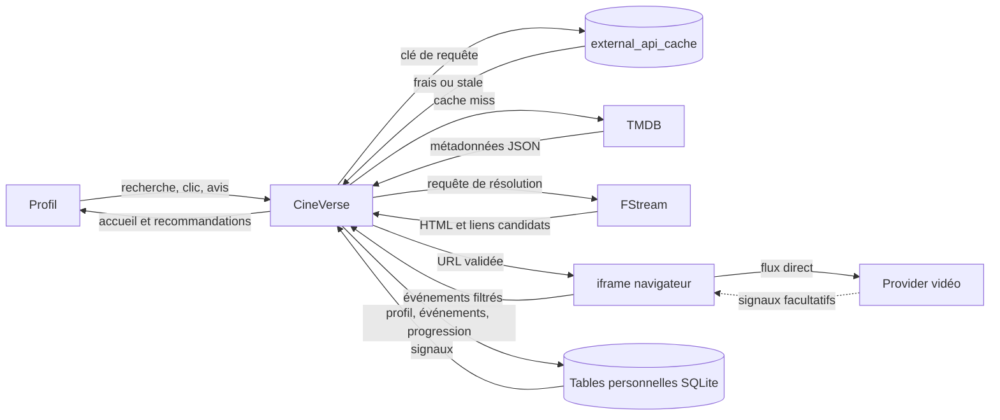
